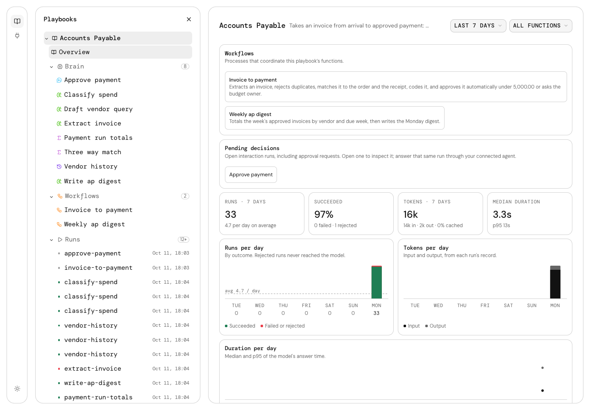

# Auto Runtime

**Describe how you want the work done.** Auto builds a working playbook you can test, change and run again. You decide when it runs and what it is allowed to do.

A playbook contains one **brain**, its reusable function collection, and **workflows** that coordinate those functions. Functions can also run directly. Each function or workflow call produces a **run** with its result and the versions used. Connections provide authorized access to external services.

Your agent builds and directs the work. **Auto Runtime** stores and executes it; [**Auto Studio**](https://studio.on.auto) lets you inspect and manage it.

## Get started

Start with hosted Auto: connect your agent to `https://mcp.on.auto`, sign in when it asks, and see your work in [Auto Studio](https://studio.on.auto). The [quick start](https://on.auto/docs/get-started/cloud) needs nothing installed and no model key.

To run Auto Runtime on your own infrastructure, every release is the image `docker.on.auto/onauto/runtime`, from Docker Hub. Your team reaches it at its `PUBLIC_URL`, the `https` address people sign in at, and opens it in Studio from `https://studio.on.auto`; see [Self-hosting](docs/self-host.md), [Run with Docker](docs/self-host/docker.md) and [Deploy for your team](docs/self-host/production.md). Auto sends an anonymous usage ping when it starts, which `DO_NOT_TRACK=1` turns off; [Usage ping](docs/self-host/configuration.md#usage-ping) lists exactly what it sends.

To run it for yourself on your own computer, `npx @on.auto/runtime` starts it in local mode, with no sign-in, on Node.js 26.10 or later on macOS or Linux; see [Run Auto on your computer](docs/get-started/local.md).

Browse the [Auto documentation](https://on.auto/docs/), and see [function availability](docs/concepts/functions.md#availability) for implemented capabilities.

_Auto Studio with synthetic Accounts Payable data._

## Contribute and get help

See [CONTRIBUTING.md](CONTRIBUTING.md) for development setup and checks, and [documentation contributions](docs/contributing/documentation.md) to preview a guide. [Open an issue](https://github.com/BeOnAuto/runtime/issues/new/choose) for bugs and questions; report vulnerabilities through [SECURITY.md](SECURITY.md).

## License

Auto Runtime is source-available under the [Elastic License 2.0](LICENSE). [LICENSING.md](LICENSING.md) explains the terms. Contributions follow the [CLA](CLA.md) and [Code of Conduct](CODE_OF_CONDUCT.md).

