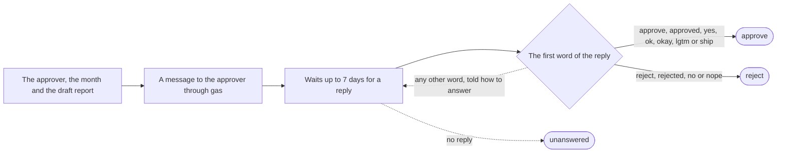

# approve-report

Sends the draft report to the approver in the team chat and waits for a reply of approve or reject in the thread.

It is given the approver, the month and the draft report. It sends the approver this message through **gas**, with the run's values in place of the words in brackets:

> :wave: Draft website report for *\[the month\]* is ready for your okay before it goes to #random.
>
> \[the draft report\]
>
> Reply *in this thread* with *approve* to log it in the tracker sheet and post it, or *reject* (optionally with a note).

It waits up to 7 days for a reply to that message, reading the replies at least 15 seconds apart. A reply whose first word is approve, approved, yes, ok, okay, lgtm or ship gives the verdict approve; one whose first word is reject, rejected, no or nope gives reject; whatever follows the first word is the note. A reply that begins with any other word is not taken, and the person is told how to answer. If nobody answers within 7 days, the request ends unanswered.

It answers with the verdict, one of approve and reject, and the note, when there is one.

## Used by

- The workflow **Monthly website report** calls it in step 6, **Send draft**.

## Details

### Input

| Field | Required | What it is |
| --- | --- | --- |
| **approver** | yes | Chat user id of the approver. Text. |
| **label** | yes | The month, such as April 2026. Text. |
| **draft** | yes | The draft report. Text, at most 6,000 characters. |

### Answer

| Field | Required | What it is |
| --- | --- | --- |
| **verdict** | yes | One of: approve, reject. |
| **note** | no | Text, at most 2,000 characters. |

### Where

To `{{ input.approver }}`. Sent through the tool `execute` of the server **gas**; the replies read with the tool `execute` of the server **gas**, at least `PT15S` apart; expires after `P7D`.

### Used by

- `monthly-website-report`, a workflow
