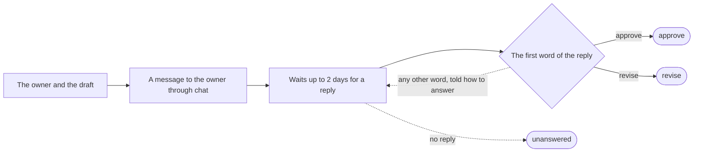

# approve-draft

Send the draft to its owner in the chat and take their approval.

It is given the owner and the draft. It sends the owner this message through **chat**, with the run's values in place of the words in brackets:

> Here is the draft:
>
> \[the draft\]
>
> Reply **approve**, or **revise** with a note of what to change.

It waits up to 2 days for a reply to that message, reading the replies at least 1 minute apart. A reply whose first word is approve gives the verdict approve; one whose first word is revise gives revise; whatever follows the first word is the note. A reply that begins with any other word is not taken, and the person is told how to answer. If nobody answers within 2 days, the request ends unanswered.

It answers with the verdict, one of approve and revise, and the note, when there is one.

## Details

### Input

| Field | Required | What it is |
| --- | --- | --- |
| **owner** | yes | Text. |
| **draft** | yes | Text, at most 4,000 characters. |

### Answer

| Field | Required | What it is |
| --- | --- | --- |
| **verdict** | yes | One of: approve, revise. |
| **note** | no | Text, at most 2,000 characters. |

### Where

To `{{ input.owner }}`, whose reply alone answers it. Sent through the tool `post_message` of the server **chat**; the replies read with the tool `thread_replies` of the server **chat**, at least `PT1M` apart; expires after `P2D`.
